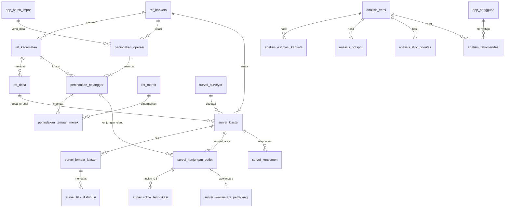

# Basis Data SIPATRI: Peta Peredaran Rokok Ilegal Jawa Tengah

Rancangan skema PostgreSQL + PostGIS untuk aplikasi yang diusulkan pada Bab V Laporan Pendahuluan.
Status: **sudah diuji pada PostgreSQL 17 + PostGIS 3.5.2 (Docker), 25 November 2026**, termasuk fungsi spasial, indeks GIST, trigger, dan batas desa/kelurahan. Rincian uji di [Hasil uji](#hasil-uji).

| Berkas | Isi |
|---|---|
| `01_skema.sql` | Skema, tabel, indeks, trigger, view, dan peran basis data |
| `02_data_referensi.sql` | Data awal: 35 kab/kota, 576 kecamatan, 8.563 desa/kelurahan, 12 surveyor, 103 klaster hasil undian, merek, bobot skor, batas kab/kota sementara |
| `03_uji_fungsi.sql` | Skrip uji fungsi; hanya untuk basis data uji karena menambah data contoh |
| `04_batas_turunan.sql` | Menyusun batas desa/kelurahan dari cincin poligon mentah, lalu menurunkan batas kecamatan dan kab/kota (menggantikan batas sementara). Dijalankan setelah `buat_batas_desa.php` |
| `buat_batas_desa.php` | Membuat SQL pemuat cincin poligon (`stg.cincin`) dari `data-wilayah/batas_desa/*.sql` (sumber: cahyadsn/wilayah_boundaries, MIT) |
| `buat_data_referensi.ps1` | Skrip pembuat `02_data_referensi.sql` dari berkas proyek |

## Data sumber yang tidak ada di repositori

Repositori ini hanya memuat kode dan data referensi hasil olahan (`02_data_referensi.sql`). Berkas sumber berikut **tidak** disertakan dan diperoleh sendiri bila perlu membuat ulang data:

- `data-wilayah/wilayah.sql` (kode wilayah Kemendagri) dan `data-wilayah/hasil_undian.csv`: dipakai `buat_data_referensi.ps1`. Kode wilayah dari [cahyadsn/wilayah](https://github.com/cahyadsn/wilayah) (MIT); hasil undian klaster berasal dari dokumen perencanaan survei.
- `data-wilayah/batas_desa/*.sql`: dipakai `buat_batas_desa.php`. Unduh folder `db/kel/33` dari [cahyadsn/wilayah_boundaries](https://github.com/cahyadsn/wilayah_boundaries) (MIT) ke `data-wilayah/batas_desa/`.
- Berkas Excel hasil operasi cukai (memuat nama dan alamat pelaku usaha): tidak boleh dimasukkan ke repositori publik; diunggah lewat menu Impor aplikasi.

## Memuat batas desa/kelurahan

```powershell
php buat_batas_desa.php ..\..\data-wilayah\batas_desa muat_batas_desa.sql
docker cp muat_batas_desa.sql peta-db:/tmp/muat_batas_desa.sql
docker cp 04_batas_turunan.sql peta-db:/db/04_batas_turunan.sql
docker exec peta-db psql -U postgres -d peta_rokok_ilegal -v ON_ERROR_STOP=1 -f /tmp/muat_batas_desa.sql
docker exec peta-db psql -U postgres -d peta_rokok_ilegal -v ON_ERROR_STOP=1 -f /db/04_batas_turunan.sql
docker exec peta-db psql -U postgres -d peta_rokok_ilegal -c "DROP SCHEMA stg CASCADE"
```

Hasil: 8.561 dari 8.563 desa/kelurahan berpoligon (semua kodenya cocok dan namanya sama dengan `ref.desa`; belum ada di sumber: Bojongsari 33.05.11.2001 dan Sodong Basari 33.27.03.2013), 576 kecamatan, 35 kab/kota, seluruhnya valid. Poligon sudah disederhanakan oleh pembuat sumber dan **bukan batas resmi**; ganti dengan data BIG/BPS/Bappeda sebelum dipakai menetapkan batas wilayah.

## Cara menjalankan

```sql
-- 1. Buat basis data (sebagai superuser)
CREATE DATABASE peta_rokok_ilegal;
-- 2. Sambungkan ke basis data itu, lalu jalankan berurutan:
\i 01_skema.sql
\i 02_data_referensi.sql
```

Peran `peta_aplikasi`, `peta_analis`, dan `peta_geoserver` dibuat oleh `01_skema.sql`; menjalankannya perlu hak superuser atau CREATEROLE.

## Pembagian skema

| Skema | Isi | Siapa yang memakai |
|---|---|---|
| `ref` | Wilayah (kab/kota, kecamatan, desa) beserta batasnya, titik keramaian, merek, tarif, data pendukung | Semua |
| `app` | Pengguna, batch impor (versi data), log audit | Aplikasi |
| `penindakan` | Isi DATA GABUNGAN OPERASI CUKAI 2023–2026 dan pembaruannya: operasi → pelanggar → temuan per merek | Aplikasi; analis lewat view anonim |
| `survei` | Hasil KoboToolbox: klaster, lembar klaster, titik distribusi, kunjungan outlet, rokok terindikasi, wawancara pedagang, konsumen | Aplikasi, analis |
| `analisis` | Versi analisis, bobot, estimasi kerugian, hotspot, skor prioritas, draf rekomendasi | Analis menulis, aplikasi membaca |
| `publik` | View lapisan peta tanpa data pribadi dan tanpa titik outlet | GeoServer, peran penampil |

## Diagram relasi utama



## Hal penting dalam rancangan

- **Kode wilayah Kemendagri sebagai kunci.** Kab/kota `33.20`, kecamatan `33.20.01`, desa `33.20.01.2001`. Kolom `ref.desa.jenis` (Desa/Kelurahan) terisi otomatis dari kode.
- **Data penindakan dinormalkan** menjadi operasi, pelanggar, dan temuan per merek, sehingga rekap per kab/kota, bulan, dan merek dihitung oleh view (`penindakan.v_rekap_*`) dan tidak perlu diketik ulang.
- **Versi data dan rollback.** Setiap unggahan menjadi satu baris `app.batch_impor`. Data hanya tampil bila batch berstatus `disimpan`; `app.batalkan_impor(id)` menonaktifkan batch yang salah.
- **Log audit otomatis** untuk pengguna, batch impor, tarif, bobot skor, rekomendasi, dan klaster. Aplikasi menyetel `SET LOCAL app.pengguna_id = '...'` di setiap transaksi agar pelaku tercatat.
- **Lokasi otomatis.** Trigger mengisi `kode_desa` dari titik GPS outlet dan pelanggar dengan `ST_Intersects` terhadap batas desa.
- **Indikasi rokok ilegal dihitung basis data.** Kolom `survei.kunjungan_outlet.berindikasi` = C2 bernilai 1 atau C3 berisi a–d/f.
- **Data pribadi dipisah.** Nama pemilik, nama toko, dan alamat hanya ada di tabel dasar dan `penindakan.v_pelanggar` (admin). Analis memakai `v_pelanggar_anonim`; GeoServer hanya membaca skema `publik`. Konsumen tidak punya titik GPS.
- **Jawaban lengkap tetap tersimpan** di kolom `data_mentah` (jsonb), sedangkan pertanyaan yang dipakai analisis disimpan sebagai kolom biasa dengan kode yang sama dengan instrumen.
- **Rekomendasi berstatus draf** sampai disetujui; basis data menolak status `disetujui` tanpa nama dan waktu persetujuan.

## Contoh kueri

```sql
-- Pelanggar per kab/kota dan tahun (pengganti sheet REKAP KAB-KOTA)
SELECT k.nama, r.tahun, r.operasi, r.pelanggar, r.jumlah_batang
FROM penindakan.v_rekap_kabkota r JOIN ref.kabkota k ON k.kode = r.kode_kab
ORDER BY r.pelanggar DESC;

-- Proporsi outlet berindikasi per wilayah eks-karesidenan (belum berbobot)
SELECT k.wilayah_eks,
       count(*) FILTER (WHERE o.berindikasi)::numeric / count(*) AS proporsi
FROM survei.kunjungan_outlet o
JOIN survei.klaster s ON s.id_klaster = o.id_klaster
JOIN ref.kabkota k ON k.kode = s.kode_kab
WHERE o.jenis_sampel = 'area' AND o.menjual_rokok
GROUP BY k.wilayah_eks;

-- Outlet berindikasi dalam radius 1 km dari pasar
SELECT o.id_outlet, p.nama AS pasar
FROM survei.kunjungan_outlet o
JOIN ref.poi p ON p.jenis = 'pasar'
 AND ST_DWithin(o.geom::geography, p.geom::geography, 1000)
WHERE o.berindikasi;
```

## Hasil uji

Diuji 25 November 2026 pada PostgreSQL 17.6 (Windows, portabel). PostGIS 3.7 tidak dapat dimuat karena berkas `postgis-3.dll` yang tidak bertanda tangan diblokir oleh Smart App Control Windows. Pengaturan keamanan itu tidak diubah. Untuk uji ini kolom `geometry` diganti sementara dengan `bytea` dan indeks GIST dilewati; berkas asli tidak berubah.

| Yang diuji | Hasil |
|---|---|
| Pemuatan `01_skema.sql` dan `02_data_referensi.sql` | Berhasil tanpa galat |
| Data referensi | 35 kab/kota, 576 kecamatan, 8.563 desa/kelurahan (753 kelurahan), 103 klaster (59 indikasi, semua punya desa cadangan), 6 kab/kota koridor, bobot skor 100% |
| Operator tanpa kab/kota | Ditolak |
| Impor penindakan | Saat pratinjau tidak tampil; setelah `simpan_impor` tampil (1 pelanggar, 600 batang); setelah `batalkan_impor` hilang lagi |
| Normalisasi merek | "Hummer" tercatat sebagai HUMER lewat alias |
| View rekap dan view publik | Angka sesuai data uji |
| Kolom `berindikasi` | Benar untuk tiga kasus (C2 = 1, C3 = e, C3 = a) |
| Sampel area tanpa klaster, porsi konsumen 11 dari 10, rekomendasi disetujui tanpa penyetuju | Ditolak |
| Log audit | Mencatat pelaku dari `app.pengguna_id`; hash kata sandi dan rahasia 2FA tidak ikut tersimpan |
| Hak akses | `peta_geoserver` hanya bisa membaca skema `publik`; `peta_analis` bisa membaca view anonim tetapi tidak bisa membaca nama pemilik |

**Perbaikan dari hasil uji:** fungsi `app.fn_audit()` semula menyalin seluruh baris `app.pengguna`, termasuk hash kata sandi, ke log audit. Kolom `kata_sandi_hash` dan `totp_rahasia` kini dibuang sebelum disimpan.

**Belum diuji:** fungsi spasial PostGIS, indeks GIST, trigger pengisi `kode_desa` dari titik GPS, pemuatan batas kab/kota, dan kueri `ST_DWithin`. Bagian ini perlu diuji di server Linux atau Docker (misalnya image `postgis/postgis:17-3.5`) sebelum aplikasi dibangun.

## Catatan

- Saat `02_data_referensi.sql` dijalankan, log audit ikut mencatat 103 klaster dan 5 bobot skor dengan `pengguna_id` kosong. Ini wajar: baris itu menandai pemuatan awal oleh sistem.
- Batas kab/kota di `02_data_referensi.sql` hanya **sementara** (disederhanakan, sumber ghapsara/indonesia-atlas, data sekitar 2016). Batas kecamatan dan desa belum ada. Batas resmi perlu diperoleh dari BIG, BPS, atau Bappeda (Bab VII Laporan Pendahuluan).
- Data penindakan 2023–2026 belum dimuat; pemuatan dilakukan lewat fitur impor aplikasi (alur pada Gambar "Alur impor data penindakan").
- Tarif cukai, pajak rokok, dan PPN di `ref.tarif` sengaja dikosongkan; diisi admin sesuai regulasi yang berlaku.
- Pengguna dan peran aplikasi (admin, operator, penampil) dikelola di Laravel. Batas data per kab/kota untuk operator dijaga di lapisan aplikasi; bila perlu dapat ditambah Row-Level Security PostgreSQL.
